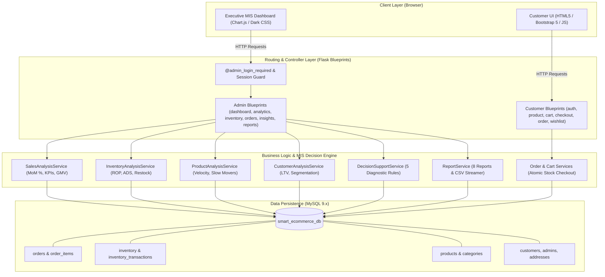
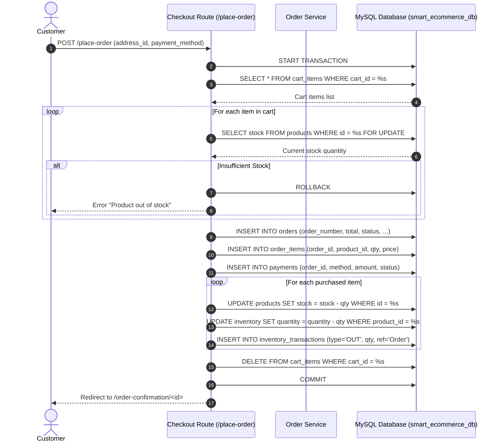
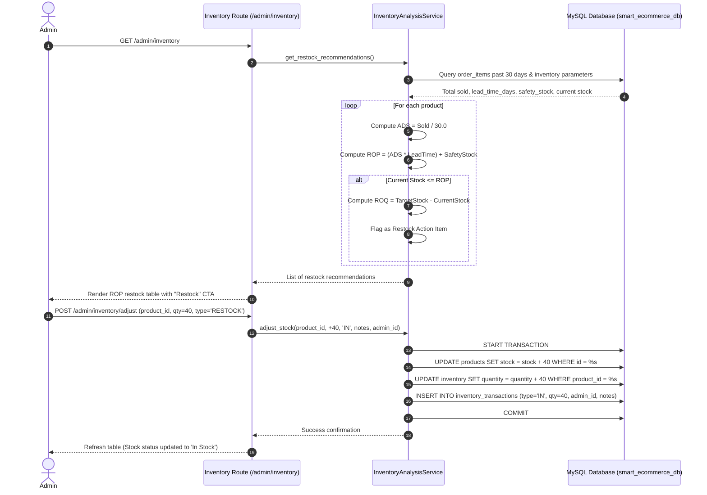

# PROJECT FACTS: SMART E-COMMERCE DECISION SUPPORT SYSTEM (SEDSS)

> **Document Purpose:** Empirical project facts extracted directly from source code, database schemas, configuration files, test suites, and git logs of the repository. Intended as the authoritative reference sheet for the B.Tech Final Year Project Report.

---

## 1. PROJECT OVERVIEW

### 1.1 Official Project Name
- **Full Title:** Smart E-Commerce Decision Support System (SEDSS)
- **Customer Storefront Brand:** VIVA – LIVE BETTER
- **Administration & Analytics Interface:** VIVA Executive MIS Decision Support Portal

### 1.2 Description
VIVA is an enterprise-grade, full-stack Management Information System (MIS) and e-commerce web platform developed using Python Flask, MySQL, Bootstrap 5, and Chart.js. The system integrates two core subsystems on a unified codebase and shared database:
1. A customer purchasing website delivering product discovery, multi-criteria filtering, shopping cart lifecycle management, customer wishlist, atomic checkout, and visual shipment tracking.
2. An Executive MIS Decision Support System (DSS) providing real-time KPI synthesis, mathematical inventory Reorder Point (ROP) restock planning, slow-moving dead-capital identification, automated prescriptive business recommendations, behavioral customer segmentation, and multi-format business reporting with CSV export.

### 1.3 Problem It Solves
Traditional e-commerce platforms function primarily as transactional record-keepers without translating operational data into actionable managerial intelligence. Small and medium enterprises (SMEs) face frequent stockouts on top revenue drivers, working capital entrapment in stagnant inventory, delayed supplier purchase orders, and lack of customer retention visibility. SEDSS addresses this by executing mathematical inventory optimization algorithms ($ROP$, $ADS$, $SafetyStock$) and rule-based diagnostic analytics directly against live transactional tables to guide managerial decision-making.

### 1.4 Target Users
1. **Online Customers / Retail Consumers:** Browse products, place orders, track delivery milestones, manage addresses and personal profiles.
2. **Operations & Inventory Managers:** Monitor real-time warehouse stock, track stockout risks, receive calculated reorder point suggestions, adjust inventory counts with audit trails.
3. **E-Commerce Business Analysts & Executives:** Analyze monthly gross merchandise value (GMV), monitor sales velocity, identify slow-moving dead stock, evaluate customer retention, and export audit-ready business reports.
4. **Store Administrators:** Manage product catalog entries, oversee category hierarchies, and process order status transitions.

### 1.5 Technology Stack and Explicit Versions
- **Backend Framework:** Python Flask (v3.1.3)
- **Runtime Environment:** Python (v3.11.x)
- **Database Management System:** MySQL Server (v9.6 / 8.0+ compatible), running on port 3306
- **Database Driver:** PyMySQL (v1.2.4) using `DictCursor` with explicit transaction management (`autocommit=False`)
- **Environment & Configuration:** python-dotenv (v1.2.2)
- **Cryptographic Security:** Werkzeug (v3.1.8) using `werkzeug.security` (`generate_password_hash`, `check_password_hash` via `scrypt`)
- **Frontend Framework:** Bootstrap (v5.3.2)
- **Iconography:** Bootstrap Icons (v1.11.3)
- **Client-Side Data Visualization:** Chart.js (v4.4.1 UMD distribution)
- **Typography:** Google Fonts (*Plus Jakarta Sans*, *JetBrains Mono*, *Playfair Display*)
- **Automated Testing & HTTP Verification:** Requests (v2.31.0+)
- **ML / Analytics Libraries:**
  - Specialized Python ML libraries (e.g. Scikit-learn, TensorFlow): **NOT FOUND** (Analytical and decision support algorithms are implemented deterministically via pure Python and SQL aggregates to prevent binary platform incompatibilities and ensure deterministic auditability).
  - Data Processing: Python standard library `csv` (RFC 4180 compliant) and `io.StringIO`.

### 1.6 Repository Information
- **Remote Git URL:** `https://github.com/SHERSHAM/MIS-smart_ecommerce.git`
- **Default Branch:** `main`

### 1.7 Repository Directory Structure (3 Levels Deep)
```
smart_ecommerce/
├── .env.example
├── .gitignore
├── app.py
├── config.py
├── database.sql
├── README.md
├── requirements.txt
├── test_routes.py
├── test_system.py
├── admin_portal/
│   ├── test_admin_portal.py
│   ├── test_live_workflow.py
│   ├── migrations/
│   │   └── create_admin_table.sql
│   ├── routes/
│   │   ├── admin_analytics_routes.py
│   │   ├── admin_auth_routes.py
│   │   ├── admin_category_routes.py
│   │   ├── admin_customer_routes.py
│   │   ├── admin_dashboard_routes.py
│   │   ├── admin_insights_routes.py
│   │   ├── admin_inventory_routes.py
│   │   ├── admin_order_routes.py
│   │   ├── admin_product_routes.py
│   │   └── admin_report_routes.py
│   ├── services/
│   │   ├── customer_analysis_service.py
│   │   ├── decision_support_service.py
│   │   ├── inventory_analysis_service.py
│   │   ├── product_analysis_service.py
│   │   ├── report_service.py
│   │   └── sales_analysis_service.py
│   ├── static/
│   │   ├── css/
│   │   │   └── admin_dark.css
│   │   └── js/
│   │       └── admin_charts.js
│   └── templates/
│       └── admin/
│           ├── admin_base.html
│           ├── admin_login.html
│           ├── dashboard.html
│           ├── analytics/
│           ├── categories/
│           ├── customers/
│           ├── insights/
│           ├── inventory/
│           ├── orders/
│           ├── products/
│           └── reports/
├── models/
│   ├── __init__.py
│   ├── address.py
│   ├── admin.py
│   ├── cart.py
│   ├── category.py
│   ├── customer.py
│   ├── order.py
│   ├── product.py
│   └── wishlist.py
├── routes/
│   ├── __init__.py
│   ├── auth_routes.py
│   ├── cart_routes.py
│   ├── checkout_routes.py
│   ├── customer_routes.py
│   ├── order_routes.py
│   ├── product_routes.py
│   └── wishlist_routes.py
├── services/
│   ├── cart_service.py
│   ├── inventory_service.py
│   └── order_service.py
├── static/
│   ├── css/
│   │   ├── responsive.css
│   │   └── style.css
│   ├── images/
│   │   └── products/
│   └── js/
│       └── main.js
└── templates/
    ├── base.html
    ├── auth/
    │   ├── forgot_password.html
    │   ├── login.html
    │   └── register.html
    └── customer/
        ├── addresses.html
        ├── cart.html
        ├── checkout.html
        ├── home.html
        ├── my_orders.html
        ├── order_confirmation.html
        ├── order_details.html
        ├── product_details.html
        ├── profile.html
        ├── shop.html
        ├── static_page.html
        ├── track_order.html
        └── wishlist.html
```

---

## 2. MODULES AND FEATURES

### 2.1 Admin Portal Route Files (`admin_portal/routes/`)

#### 1. `admin_analytics_routes.py`
- **Purpose:** Handles the MIS Decision Analytics overview page, showing top-performing velocity leaders, 30-day slow-moving items, and interactive revenue trajectories.
- **Blueprint Name:** `admin_analytics_bp` (prefixed with `/admin`)
- **Endpoints:**
  - `GET /admin/analytics`: Invokes `analytics_overview()`.
- **Inputs:** Query parameter `days` (integer: e.g., 7, 30, 90; optional).
- **Outputs:** Renders `admin/analytics/index.html` passing `top_sellers`, `slow_movers`, `monthly_trend`, `category_dist`, and `days_filter`.
- **Algorithm / Formula Used:**
  - Dynamic time-window SQL cutoff: $\text{cutoff} = \text{now}() - \text{days}$.
  - Velocity Leader Ranking: Sorted descending by $\sum(\text{quantity})$ and $\sum(\text{subtotal})$.

#### 2. `admin_auth_routes.py`
- **Purpose:** Manages administrator authentication, session establishment, credential verification, and session termination.
- **Blueprint Name:** `admin_auth_bp` (prefixed with `/admin`)
- **Endpoints:**
  - `GET /admin/login`: Renders `admin/admin_login.html`.
  - `POST /admin/login`: Handles form submission (`identifier`, `password`). Verifies scrypt password hash; populates `session['admin_id']`, `session['admin_username']`, `session['admin_name']`, `session['admin_role']`; updates `admins.last_login`.
  - `GET /admin/logout`: Clears admin session keys and redirects to `/admin/login`.
- **Decorator:** `@admin_login_required` wraps protected admin endpoints. Inspects `session.get('admin_id')`; if absent, redirects to `/admin/login?next=<path>` with a flash warning.

#### 3. `admin_category_routes.py`
- **Purpose:** Product taxonomy management, category creation, editing, and safe deletion.
- **Blueprint Name:** `admin_category_bp` (prefixed with `/admin`)
- **Endpoints:**
  - `GET /admin/categories`: `category_list()`, queries all categories with live count of associated active products. Renders `admin/categories/index.html`.
  - `POST /admin/categories/add`: `add_category()`, receives `name`, `icon`, `image`, `description`. Auto-generates URL slug using regex `re.sub(r'[^a-zA-Z0-9]+', '-', name.lower())`.
  - `POST /admin/categories/edit/<int:category_id>`: `edit_category()`, updates category record.
  - `POST /admin/categories/delete/<int:category_id>`: `delete_category()`. Enforces safe-delete logic: queries `Category.get_product_count(category_id)`. If count > 0, aborts deletion and returns warning.

#### 4. `admin_customer_routes.py`
- **Purpose:** Customer intelligence, customer lifetime value (LTV) profiling, and order history inspection.
- **Blueprint Name:** `admin_customer_bp` (prefixed with `/admin`)
- **Endpoints:**
  - `GET /admin/customers`: `customer_list()`, accepts query param `q`. Invokes `CustomerAnalysisService.get_customer_intelligence_list(search)` and `get_customer_summary_metrics()`. Renders `admin/customers/index.html`.
  - `GET /admin/customers/<int:customer_id>`: `customer_detail()`, fetches customer profile, orders list, and non-cancelled total spend. Renders `admin/customers/details.html`.

#### 5. `admin_dashboard_routes.py`
- **Purpose:** Executive dashboard landing page rendering high-level KPIs, Chart.js datasets, and recent order feeds.
- **Blueprint Name:** `admin_dashboard_bp` (prefixed with `/admin`)
- **Endpoints:**
  - `GET /admin/`: Redirects to `/admin/dashboard`.
  - `GET /admin/dashboard`: `dashboard()`, aggregates `get_dashboard_kpis()`, `get_monthly_revenue_trend(6)`, `get_category_sales_distribution()`, `get_order_status_distribution()`, `get_top_selling_products(5)`, `get_customer_summary_metrics()`, and `get_recent_orders(6)`. Renders `admin/dashboard.html`.

#### 6. `admin_insights_routes.py`
- **Purpose:** Presents synthesized, rule-based prescriptive recommendations generated by the Decision Support System engine.
- **Blueprint Name:** `admin_insights_bp` (prefixed with `/admin`)
- **Endpoints:**
  - `GET /admin/insights`: `insights_view()`, calls `DecisionSupportService.generate_all_recommendations()`. Renders `admin/insights/index.html`.

#### 7. `admin_inventory_routes.py`
- **Purpose:** Warehouse stock tracking, threshold monitoring, manual inventory adjustment execution, and audit log inspection.
- **Blueprint Name:** `admin_inventory_bp` (prefixed with `/admin`)
- **Endpoints:**
  - `GET /admin/inventory`: `inventory_list()`, query params `status` ('low', 'out', 'all') and `q`. Retrieves inventory items and ROP restock recommendations. Renders `admin/inventory/index.html`.
  - `POST /admin/inventory/adjust`: `adjust_stock()`, receives `product_id`, `quantity` / `quantity_change`, `adjustment_type` ('RESTOCK', 'RETURN', 'DAMAGE', 'SCRAP', 'CORRECTION'), and `notes`. Executes transactional stock modification with audit logging in `inventory_transactions`.
  - `GET /admin/inventory/transactions`: `transactions()`, fetches historical inventory audit trail ledger. Renders `admin/inventory/transactions.html`.

#### 8. `admin_order_routes.py`
- **Purpose:** Customer order processing, shipping milestone status transitions, and order cancellation stock reversals.
- **Blueprint Name:** `admin_order_bp` (prefixed with `/admin`)
- **Endpoints:**
  - `GET /admin/orders`: `order_list()`, query params `status`, `payment`, `q`. Renders `admin/orders/index.html`.
  - `GET /admin/orders/<int:order_id>`: `order_detail()`, renders order items, delivery address, and payment information in `admin/orders/details.html`.
  - `POST /admin/orders/update-status/<int:order_id>`: `update_status()`, transitions order status among `['Pending', 'Confirmed', 'Processing', 'Shipped', 'Delivered', 'Cancelled']`.
- **Stock Reversal Algorithm:** If status transitions to `'Cancelled'`, queries all `order_items` for that order, increments `products.stock` by the purchased quantity, synchronizes `inventory.quantity`, and inserts an `'IN'` transaction in `inventory_transactions` tagged `'Order Cancellation Restock'`.

#### 9. `admin_product_routes.py`
- **Purpose:** Catalog CRUD, secure image uploading, and active/inactive visibility toggles.
- **Blueprint Name:** `admin_product_bp` (prefixed with `/admin`)
- **Endpoints:**
  - `GET /admin/products`: `product_list()`, filtered by `category`, `status`, `q`. Renders `admin/products/index.html`.
  - `GET,POST /admin/products/add`: `add_product()`, handles SKU uniqueness validation, image upload (`werkzeug.utils.secure_filename`), creates row in `products`, and creates initial row in `inventory`. Renders/redirects to `admin/products/form.html`.
  - `GET,POST /admin/products/edit/<int:product_id>`: `edit_product()`, updates product metadata and synchronizes `inventory` quantity.
  - `POST /admin/products/toggle-status/<int:product_id>`: `toggle_status()`, executes `UPDATE products SET is_active = NOT is_active WHERE id = %s`.

#### 10. `admin_report_routes.py`
- **Purpose:** Interactive business report viewer and on-demand RFC 4180 CSV generation.
- **Blueprint Name:** `admin_report_bp` (prefixed with `/admin`)
- **Endpoints:**
  - `GET /admin/reports`: `report_view()`, query params `type` (one of 8 supported reports), `start_date`, `end_date`. Renders `admin/reports/index.html`.
  - `GET /admin/reports/export-csv`: `export_csv()`, streams dynamically constructed CSV file with `Content-Type: text/csv` and `Content-Disposition: attachment; filename=VIVA_<type>_<timestamp>.csv`.

---

### 2.2 Customer Storefront Route Files (`routes/`)

1. **`auth_routes.py` (`auth_bp`):**
   - Endpoints: `GET,POST /register`, `GET,POST /login`, `GET /logout`, `GET,POST /forgot-password`.
   - Handles customer registration, email validation, password hashing (`scrypt`), customer session establishment (`session['customer_id']`), and cart migration from guest sessions.
2. **`cart_routes.py` (`cart_bp`):**
   - Endpoints: `GET /cart`, `GET,POST /add-to-cart`, `GET,POST /update-cart`, `GET,POST /remove-from-cart`, `GET,POST /clear-cart`.
   - Manages persistent cart storage in MySQL tables `cart` and `cart_items`. Calculates free shipping eligibility (order subtotal $\ge 999 \implies \text{shipping} = 0$, else $49$).
3. **`checkout_routes.py` (`checkout_bp`):**
   - Endpoints: `GET,POST /checkout`, `POST /place-order`, `GET /order-confirmation/<int:order_id>`.
   - Enforces transactional checkout: creates `orders` record, inserts individual `order_items`, logs `payments` (COD or Simulated Online), decrements `products.stock`, updates `inventory.quantity`, inserts `inventory_transactions` record, and purges `cart_items`.
4. **`customer_routes.py` (`customer_bp`):**
   - Endpoints: `GET /` (home), `GET,POST /profile`, `GET,POST /addresses`, `GET /about`, `GET /contact`, `GET /faq`, `GET /privacy`, `GET /terms`, `GET /shipping-info`, `GET /returns`, `POST /newsletter-subscribe`.
5. **`order_routes.py` (`order_bp`):**
   - Endpoints: `GET /my-orders`, `GET /order-details/<int:order_id>`, `GET,POST /track-order`.
   - Visual milestone tracker mapping database status to a 5-step UI stepper.
6. **`product_routes.py` (`product_bp`):**
   - Endpoints: `GET /shop`, `GET /product/<int:product_id>`, `GET /category/<int:category_id>`, `GET /search`, `GET /deals`, `GET /new-arrivals`.
   - Supports multi-attribute filtering (category, price min/max, brand, in-stock only) and sorting (`price_asc`, `price_desc`, `rating`, `newest`, `popular`).
7. **`wishlist_routes.py` (`wishlist_bp`):**
   - Endpoints: `GET /wishlist`, `GET,POST /add-to-wishlist`, `GET,POST /remove-from-wishlist`, `GET,POST /move-to-cart`.

---

### 2.3 MIS Analytical & Decision Support Services (`admin_portal/services/`)

#### 1. `sales_analysis_service.py` (`SalesAnalysisService`)
- **Key Functions:**
  - `get_dashboard_kpis()`: Computes total non-cancelled revenue, total orders, distinct customers, active catalog items, pending orders, low-stock alerts, and Month-over-Month (MoM) revenue growth percentage.
  - `get_monthly_revenue_trend(months=6)`: Groups non-cancelled orders by year-month (`DATE_FORMAT(created_at, '%%Y-%%m')`) to extract monthly labels, total revenue, and order volume.
  - `get_category_sales_distribution()`: Joins `categories`, `products`, `order_items`, and `orders` to compute gross merchandise value (GMV) and units sold per category.
  - `get_order_status_distribution()`: Counts orders grouped by status (`Pending`, `Confirmed`, `Processing`, `Shipped`, `Delivered`, `Cancelled`).
  - `get_recent_orders(limit=6)`: Retrieves the most recent order records with payment methods.
- **Mathematical Formulas:**
  - **Month-over-Month Growth Percentage ($MoM$):**
    $$MoM = \begin{cases} \left(\frac{\text{Current Month Revenue} - \text{Prior Month Revenue}}{\text{Prior Month Revenue}}\right) \times 100, & \text{if Prior Month Revenue} > 0 \\ 100.0, & \text{if Prior Month Revenue} = 0 \text{ and Current} > 0 \\ 0.0, & \text{otherwise} \end{cases}$$

#### 2. `product_analysis_service.py` (`ProductAnalysisService`)
- **Key Functions:**
  - `get_top_selling_products(limit=10, days=None)`: Aggregates order item quantities and subtotal revenues per product, applying an optional time window cutoff. Injects a 1-based `sales_rank`.
  - `get_slow_moving_products(days=30, max_sales=1)`: Identifies items with catalog age $\ge 14$ days, current stock $> 0$, and recent sales $\le \text{max\_sales}$ (default 1 unit in 30 days). Computes idle locked capital.
- **Mathematical Formulas & Decision Rules:**
  - **Locked Working Capital:**
    $$\text{Locked Capital} = \text{Product Price} \times \text{Current On-Hand Stock}$$
  - **Slow-Mover Action Matrix:**
    - If $\text{Stock} \ge 40$: Urgency = `"High"`; Action = *"Launch a Flash Discount (15-25% off) to liquidate surplus inventory and free working capital."*
    - If $20 \le \text{Stock} < 40$: Urgency = `"Medium"`; Action = *"Feature in 'Home Refresh' or 'Weekly Deals' carousel to boost organic visibility."*
    - If $\text{Stock} < 20$: Urgency = `"Low"`; Action = *"Monitor demand; hold off on placing restocking purchase orders until velocity improves."*

#### 3. `inventory_analysis_service.py` (`InventoryAnalysisService`)
- **Key Functions:**
  - `get_inventory_status_list(status_filter, search)`: Maps stock quantities to categorical states:
    - $\text{Stock} = 0 \implies \text{'Out of Stock'}$ (`badge: danger`)
    - $0 < \text{Stock} \le \text{Threshold} \implies \text{'Low Stock'}$ (`badge: warning`)
    - $\text{Stock} > \text{Threshold} \implies \text{'In Stock'}$ (`badge: success`)
  - `get_restock_recommendations()`: Identifies all active products where current stock $\le$ calculated or configured Reorder Point ($ROP$).
  - `adjust_stock(product_id, quantity_change, transaction_type, reason, admin_id)`: Atomic method updating `products.stock`, `inventory.quantity`, and inserting audit records in `inventory_transactions`. Maps friendly inputs (`RESTOCK`, `RETURN`, `DAMAGE`, `SCRAP`, `CORRECTION`) to MySQL ENUM(`'IN'`, `'OUT'`, `'ADJUSTMENT'`).
  - `get_transaction_history(limit=50)`: Retrieves immutable stock movement records.
- **Mathematical Inventory Formulas:**
  - **Average Daily Sales ($ADS$):**
    $$ADS = \frac{\sum \text{Quantity Sold in Last 30 Days}}{30.0}$$
  - **Reorder Point ($ROP$):**
    $$ROP = \lceil(ADS \times \text{Lead Time Days}) + \text{Safety Stock}\rceil$$
    *(Defaults if unconfigured: Lead Time = 5 days, Safety Stock = 5 units, Fallback ROP = 15 units)*
  - **Recommended Order Quantity ($ROQ$):**
    $$\text{Target Stock} = \max(ROP \times 2.5, 30)$$
    $$ROQ = \max(\lceil\text{Target Stock} - \text{Current Stock}\rceil, 10)$$

#### 4. `customer_analysis_service.py` (`CustomerAnalysisService`)
- **Key Functions:**
  - `get_customer_intelligence_list(search)`: Calculates total spent, completed order count, and Average Order Value ($AOV$) per customer.
  - `get_customer_summary_metrics()`: Calculates store-wide unique customer count, total orders, repeat customer count, repeat buyer rate (%), and global $AOV$.
- **Formulas & Customer Segmentation Hierarchy:**
  - **Average Order Value ($AOV$):**
    $$AOV = \frac{\text{Total Spent}}{\text{Order Count}}$$
  - **Repeat Customer Rate:**
    $$\text{Repeat Rate} = \left(\frac{\text{Customers with Order Count} \ge 2}{\text{Total Customers}}\right) \times 100$$
  - **Segmentation Rules:**
    1. If $\text{Total Spent} \ge ₹25,000 \implies \textbf{VIP High-Value}$ (`badge: warning`)
    2. Else if $\text{Order Count} \ge 2 \implies \textbf{Repeat Customer}$ (`badge: success`)
    3. Else if $\text{Order Count} = 1 \implies \textbf{First-Time Buyer}$ (`badge: info`)
    4. Else $\implies \textbf{Lead / Inactive}$ (`badge: secondary`)

#### 5. `decision_support_service.py` (`DecisionSupportService`)
- **Purpose:** Central deterministic expert system running 5 discrete business evaluation rules across sales, inventory, and customer databases to synthesize managerial guidance.
- **Rule Definitions:**
  1. **Rule 1 (Imminent Stockout on Top Sellers):** Evaluates top 5 revenue-generating products. If any top seller has stock $\le 15$ units, issues a `CRITICAL` alert warning of immediate revenue forfeiture, calculating units sold and advising an expedited restock of at least 35 units.
  2. **Rule 2 (Excess Capital in Slow-Moving Inventory):** Evaluates products with $\le 1$ sale in 30 days and catalog age $\ge 14$ days. Calculates exact capital trapped ($\text{price} \times \text{stock}$) and issues a `WARNING` with targeted liquidation tactics.
  3. **Rule 3 (Category Revenue Concentration):** Evaluates GMV distribution across categories. If the leading category accounts for $> 40\%$ of store revenue, issues a `STRATEGY` signal recommending cross-selling complementary verticals to diversify risk.
  4. **Rule 4 (Revenue Momentum Trajectory):** Evaluates Month-over-Month growth ($MoM$). If $MoM \ge 0$, issues a `GROWTH` signal advising promotion continuity; if negative, issues a `WARNING` suggesting customer re-engagement discounts.
  5. **Rule 5 (Customer Retention & Repeat Ratio):** Evaluates store repeat buyer percentage. Issues a `STRATEGY` recommendation outlining loyalty tier mechanisms based on current $AOV$.

#### 6. `report_service.py` (`ReportService`)
- **Purpose:** Parameterized data extraction engine servicing 8 standardized operational reports:
  1. *Daily Sales Report* (`daily_sales`): Daily order counts, gross sales, shipping fees, net revenue.
  2. *Monthly Sales Report* (`monthly_sales`): Month-by-month order volume, total revenue, average order value.
  3. *Product Performance Report* (`product_performance`): Units sold and gross revenue per SKU.
  4. *Customer Purchase Report* (`customer_purchase`): Customer lifetime spend, order frequency, last order date.
  5. *Inventory Status Report* (`inventory_status`): On-hand inventory, total asset value, threshold, and ROP.
  6. *Low Stock Alert Report* (`low_stock`): Items at or below low-stock thresholds.
  7. *Best-Selling Products Report* (`best_sellers`): Top 15 products ranked by units sold.
  8. *Order Status Report* (`order_status`): Chronological order ledger with payment methods and values.
- **CSV Export:** Implements `export_csv(report_type, start_date, end_date)` utilizing standard library `csv.DictWriter` to stream RFC 4180-compliant CSV text with human-readable headers and timestamped formatting.

---

### 2.4 Customer Storefront Services (`services/`)
1. **`cart_service.py`:** Calculates cart subtotal, discount, shipping fee ($0$ if subtotal $\ge 999$ else $49$), and grand total.
2. **`inventory_service.py`:** Customer-facing stock check (`is_in_stock(product_id, quantity)`) and low-stock warning thresholds.
3. **`order_service.py`:** Formats order numbers (`VIVA-<YYYYMMDD>-<HEX>`) and coordinates checkout database operations.

---

## 3. DATABASE SCHEMA & RELATIONSHIPS

The database `smart_ecommerce_db` comprises **17 relational tables** defined in InnoDB with UTF-8 character encoding (`utf8mb4`).

### 3.1 Table Definitions

#### 1. `admins` (Administrator accounts & role-based credentials)
- `id` INT AUTO_INCREMENT PRIMARY KEY
- `username` VARCHAR(50) NOT NULL UNIQUE
- `email` VARCHAR(150) NOT NULL UNIQUE
- `password_hash` VARCHAR(255) NOT NULL
- `full_name` VARCHAR(100) NOT NULL
- `role` ENUM('Super Admin', 'Sales Analyst', 'Inventory Manager') DEFAULT 'Super Admin'
- `is_active` TINYINT(1) DEFAULT 1
- `last_login` TIMESTAMP NULL
- `created_at` TIMESTAMP DEFAULT CURRENT_TIMESTAMP
- `updated_at` TIMESTAMP DEFAULT CURRENT_TIMESTAMP ON UPDATE CURRENT_TIMESTAMP

#### 2. `categories` (Product hierarchical taxonomy)
- `id` INT AUTO_INCREMENT PRIMARY KEY
- `name` VARCHAR(100) NOT NULL
- `slug` VARCHAR(100) NOT NULL UNIQUE
- `description` TEXT NULL
- `image` VARCHAR(255) NULL
- `icon` VARCHAR(50) NULL
- `parent_id` INT NULL [FK $\to$ `categories.id`]
- `is_active` TINYINT(1) DEFAULT 1
- `display_order` INT DEFAULT 0
- `created_at` TIMESTAMP DEFAULT CURRENT_TIMESTAMP
- `updated_at` TIMESTAMP DEFAULT CURRENT_TIMESTAMP ON UPDATE CURRENT_TIMESTAMP

#### 3. `products` (Core catalog master table)
- `id` INT AUTO_INCREMENT PRIMARY KEY
- `category_id` INT NOT NULL [FK $\to$ `categories.id`]
- `name` VARCHAR(200) NOT NULL
- `slug` VARCHAR(200) NOT NULL UNIQUE
- `sku` VARCHAR(50) NOT NULL UNIQUE
- `brand` VARCHAR(100) NULL
- `short_description` VARCHAR(500) NULL
- `description` TEXT NULL
- `price` DECIMAL(10,2) NOT NULL
- `discount_price` DECIMAL(10,2) NULL
- `stock` INT NOT NULL DEFAULT 0
- `image_url` VARCHAR(500) NULL
- `is_featured` TINYINT(1) DEFAULT 0
- `is_deal` TINYINT(1) DEFAULT 0
- `is_new` TINYINT(1) DEFAULT 0
- `is_active` TINYINT(1) DEFAULT 1
- `rating` DECIMAL(2,1) DEFAULT 4.5
- `review_count` INT DEFAULT 0
- `created_at` TIMESTAMP DEFAULT CURRENT_TIMESTAMP
- `updated_at` TIMESTAMP DEFAULT CURRENT_TIMESTAMP ON UPDATE CURRENT_TIMESTAMP

#### 4. `product_images` (Supplementary gallery imagery)
- `id` INT AUTO_INCREMENT PRIMARY KEY
- `product_id` INT NOT NULL [FK $\to$ `products.id` ON DELETE CASCADE]
- `image_url` VARCHAR(500) NOT NULL
- `display_order` INT DEFAULT 0
- `created_at` TIMESTAMP DEFAULT CURRENT_TIMESTAMP

#### 5. `customers` (Consumer accounts)
- `id` INT AUTO_INCREMENT PRIMARY KEY
- `full_name` VARCHAR(100) NOT NULL
- `email` VARCHAR(150) NOT NULL UNIQUE
- `phone` VARCHAR(15) NULL
- `password_hash` VARCHAR(255) NOT NULL
- `is_active` TINYINT(1) DEFAULT 1
- `created_at` TIMESTAMP DEFAULT CURRENT_TIMESTAMP
- `updated_at` TIMESTAMP DEFAULT CURRENT_TIMESTAMP ON UPDATE CURRENT_TIMESTAMP

#### 6. `customer_addresses` (Delivery address book)
- `id` INT AUTO_INCREMENT PRIMARY KEY
- `customer_id` INT NOT NULL [FK $\to$ `customers.id` ON DELETE CASCADE]
- `full_name` VARCHAR(100) NOT NULL
- `phone` VARCHAR(15) NOT NULL
- `address_line1` VARCHAR(255) NOT NULL
- `address_line2` VARCHAR(255) NULL
- `city` VARCHAR(100) NOT NULL
- `state` VARCHAR(100) NOT NULL
- `pincode` VARCHAR(10) NOT NULL
- `is_default` TINYINT(1) DEFAULT 0
- `created_at` TIMESTAMP DEFAULT CURRENT_TIMESTAMP
- `updated_at` TIMESTAMP DEFAULT CURRENT_TIMESTAMP ON UPDATE CURRENT_TIMESTAMP

#### 7. `cart` (Persistent customer shopping session)
- `id` INT AUTO_INCREMENT PRIMARY KEY
- `customer_id` INT NOT NULL UNIQUE [FK $\to$ `customers.id` ON DELETE CASCADE]
- `created_at` TIMESTAMP DEFAULT CURRENT_TIMESTAMP
- `updated_at` TIMESTAMP DEFAULT CURRENT_TIMESTAMP ON UPDATE CURRENT_TIMESTAMP

#### 8. `cart_items` (Items contained in customer carts)
- `id` INT AUTO_INCREMENT PRIMARY KEY
- `cart_id` INT NOT NULL [FK $\to$ `cart.id` ON DELETE CASCADE]
- `product_id` INT NOT NULL [FK $\to$ `products.id` ON DELETE CASCADE]
- `quantity` INT NOT NULL DEFAULT 1
- `created_at` TIMESTAMP DEFAULT CURRENT_TIMESTAMP
- `updated_at` TIMESTAMP DEFAULT CURRENT_TIMESTAMP ON UPDATE CURRENT_TIMESTAMP

#### 9. `wishlist` (Customer product wishlists)
- `id` INT AUTO_INCREMENT PRIMARY KEY
- `customer_id` INT NOT NULL UNIQUE [FK $\to$ `customers.id` ON DELETE CASCADE]
- `created_at` TIMESTAMP DEFAULT CURRENT_TIMESTAMP

#### 10. `wishlist_items` (Saved wishlist items)
- `id` INT AUTO_INCREMENT PRIMARY KEY
- `wishlist_id` INT NOT NULL [FK $\to$ `wishlist.id` ON DELETE CASCADE]
- `product_id` INT NOT NULL [FK $\to$ `products.id` ON DELETE CASCADE]
- `created_at` TIMESTAMP DEFAULT CURRENT_TIMESTAMP

#### 11. `orders` (Order header master record)
- `id` INT AUTO_INCREMENT PRIMARY KEY
- `order_number` VARCHAR(50) NOT NULL UNIQUE
- `customer_id` INT NOT NULL [FK $\to$ `customers.id`]
- `address_id` INT NULL [FK $\to$ `customer_addresses.id`]
- `delivery_name` VARCHAR(100) NOT NULL
- `delivery_phone` VARCHAR(15) NOT NULL
- `delivery_email` VARCHAR(150) NOT NULL
- `delivery_address` VARCHAR(255) NOT NULL
- `delivery_city` VARCHAR(100) NOT NULL
- `delivery_state` VARCHAR(100) NOT NULL
- `delivery_pincode` VARCHAR(10) NOT NULL
- `subtotal` DECIMAL(10,2) NOT NULL
- `shipping_fee` DECIMAL(10,2) DEFAULT 0.00
- `discount` DECIMAL(10,2) DEFAULT 0.00
- `total` DECIMAL(10,2) NOT NULL
- `status` ENUM('Pending', 'Confirmed', 'Processing', 'Shipped', 'Delivered', 'Cancelled') DEFAULT 'Pending'
- `notes` TEXT NULL
- `created_at` TIMESTAMP DEFAULT CURRENT_TIMESTAMP
- `updated_at` TIMESTAMP DEFAULT CURRENT_TIMESTAMP ON UPDATE CURRENT_TIMESTAMP

#### 12. `order_items` (Historical order line items)
- `id` INT AUTO_INCREMENT PRIMARY KEY
- `order_id` INT NOT NULL [FK $\to$ `orders.id` ON DELETE CASCADE]
- `product_id` INT NOT NULL [FK $\to$ `products.id`]
- `product_name` VARCHAR(200) NOT NULL
- `product_price` DECIMAL(10,2) NOT NULL
- `quantity` INT NOT NULL
- `subtotal` DECIMAL(10,2) NOT NULL
- `created_at` TIMESTAMP DEFAULT CURRENT_TIMESTAMP

#### 13. `payments` (Financial payment transactions)
- `id` INT AUTO_INCREMENT PRIMARY KEY
- `order_id` INT NOT NULL [FK $\to$ `orders.id` ON DELETE CASCADE]
- `payment_method` ENUM('COD', 'Online') NOT NULL
- `amount` DECIMAL(10,2) NOT NULL
- `status` ENUM('Pending', 'Completed', 'Failed', 'Refunded') DEFAULT 'Pending'
- `transaction_id` VARCHAR(100) NULL
- `created_at` TIMESTAMP DEFAULT CURRENT_TIMESTAMP
- `updated_at` TIMESTAMP DEFAULT CURRENT_TIMESTAMP ON UPDATE CURRENT_TIMESTAMP

#### 14. `inventory` (Warehouse logistics parameters)
- `id` INT AUTO_INCREMENT PRIMARY KEY
- `product_id` INT NOT NULL UNIQUE [FK $\to$ `products.id` ON DELETE CASCADE]
- `quantity` INT NOT NULL DEFAULT 0
- `low_stock_threshold` INT DEFAULT 10
- `reorder_point` INT DEFAULT 15
- `lead_time_days` INT DEFAULT 5
- `safety_stock` INT DEFAULT 5
- `last_restocked` TIMESTAMP NULL
- `created_at` TIMESTAMP DEFAULT CURRENT_TIMESTAMP
- `updated_at` TIMESTAMP DEFAULT CURRENT_TIMESTAMP ON UPDATE CURRENT_TIMESTAMP

#### 15. `inventory_transactions` (Immutable inventory movement ledger)
- `id` INT AUTO_INCREMENT PRIMARY KEY
- `inventory_id` INT NOT NULL [FK $\to$ `inventory.id`]
- `product_id` INT NOT NULL [FK $\to$ `products.id`]
- `transaction_type` ENUM('IN', 'OUT', 'ADJUSTMENT') NOT NULL
- `quantity` INT NOT NULL
- `reference_type` VARCHAR(50) NULL
- `reference_id` INT NULL
- `admin_id` INT NULL [FK $\to$ `admins.id`]
- `notes` TEXT NULL
- `created_at` TIMESTAMP DEFAULT CURRENT_TIMESTAMP

#### 16. `reviews` (Product customer feedback)
- `id` INT AUTO_INCREMENT PRIMARY KEY
- `product_id` INT NOT NULL [FK $\to$ `products.id` ON DELETE CASCADE]
- `customer_id` INT NOT NULL [FK $\to$ `customers.id` ON DELETE CASCADE]
- `rating` INT NOT NULL
- `title` VARCHAR(150) NULL
- `comment` TEXT NULL
- `is_approved` TINYINT(1) DEFAULT 1
- `created_at` TIMESTAMP DEFAULT CURRENT_TIMESTAMP

#### 17. `newsletter_subscribers` (Lead capture table)
- `id` INT AUTO_INCREMENT PRIMARY KEY
- `email` VARCHAR(150) NOT NULL UNIQUE
- `is_active` TINYINT(1) DEFAULT 1
- `created_at` TIMESTAMP DEFAULT CURRENT_TIMESTAMP

---

### 3.2 Text Entity-Relationship (ER) Diagram Description
- `categories` has a 1-to-many reflexive relationship with `categories` (parent-child subcategories).
- `categories` has a 1-to-many relationship with `products` (one category contains many products).
- `products` has a 1-to-many relationship with `product_images` (one product has multiple gallery pictures).
- `products` has a 1-to-1 relationship with `inventory` (each product has one warehouse tracking record).
- `products` has a 1-to-many relationship with `inventory_transactions` (each product has an audit history of stock changes).
- `inventory` has a 1-to-many relationship with `inventory_transactions`.
- `admins` has a 1-to-many relationship with `inventory_transactions` (an administrator authors manual stock adjustments).
- `customers` has a 1-to-many relationship with `customer_addresses` (one customer has multiple delivery addresses).
- `customers` has a 1-to-1 relationship with `cart` (each customer has exactly one shopping cart).
- `cart` has a 1-to-many relationship with `cart_items` (a cart contains multiple product line items).
- `products` has a 1-to-many relationship with `cart_items`.
- `customers` has a 1-to-1 relationship with `wishlist`.
- `wishlist` has a 1-to-many relationship with `wishlist_items`.
- `products` has a 1-to-many relationship with `wishlist_items`.
- `customers` has a 1-to-many relationship with `orders` (a customer places multiple orders).
- `customer_addresses` has a 1-to-many relationship with `orders` (an address is referenced in multiple orders).
- `orders` has a 1-to-many relationship with `order_items` (an order consists of multiple purchased products).
- `products` has a 1-to-many relationship with `order_items`.
- `orders` has a 1-to-many relationship with `payments` (an order is backed by payment transaction records).
- `products` has a 1-to-many relationship with `reviews` (customers post product reviews).
- `customers` has a 1-to-many relationship with `reviews`.

---

## 4. AUTHENTICATION AND ROLES

### 4.1 System Roles
1. **Anonymous / Guest Customer:** Can view home, catalog, search, and static content. Cannot checkout or view account details without authenticating.
2. **Authenticated Customer:** Identified by `session['customer_id']`. Can manage personal profile, save multiple delivery addresses, add to cart/wishlist, place orders, and track orders.
3. **Super Admin:** Identified by `session['admin_id']` with `role = 'Super Admin'`. Complete management authority over products, categories, orders, customers, inventory stock control, decision analytics, and system-wide CSV reports.
4. **Sales Analyst (DB Enum Supported):** Designed for analytics, DSS insights, and reports inspection.
5. **Inventory Manager (DB Enum Supported):** Designed for inventory monitoring, ROP recommendations, and manual stock movements.

### 4.2 Authentication Flow & Security Architecture
- **Password Hashing:** Uses `werkzeug.security.generate_password_hash(password, method='scrypt')` producing a salted, collision-resistant cryptographic hash (`scrypt:32768:8:1$...`). Plaintext passwords are never stored.
- **Session Isolation:**
  - Customer sessions strictly store: `customer_id`, `customer_name`, `customer_email`.
  - Admin sessions strictly store: `admin_id`, `admin_username`, `admin_name`, `admin_role`.
  - Neither portal can access or spoof the other; admin routes check `@admin_login_required` which verifies `session.get('admin_id')`.
- **Public Admin Registration:** Deliberately **DISABLED**. There is no `/admin/register` route. Administrator accounts can only be provisioned via controlled database migrations or existing administrators.

### 4.3 Feature vs. Role Access Matrix

| Feature / URL Endpoint | Guest / Visitor | Customer | Inventory Manager | Sales Analyst | Super Admin |
| :--- | :---: | :---: | :---: | :---: | :---: |
| Browse Catalog (`/`, `/shop`, `/product/<id>`) | Allowed | Allowed | Allowed | Allowed | Allowed |
| Search & Filter Products (`/search`, `/category/<id>`) | Allowed | Allowed | Allowed | Allowed | Allowed |
| Add to Cart / Wishlist (`/cart`, `/wishlist`) | Redirects to Login | Allowed | Blocked (Customer Only) | Blocked (Customer Only) | Blocked (Customer Only) |
| Checkout & Place Orders (`/checkout`, `/place-order`) | Blocked | Allowed | Blocked | Blocked | Blocked |
| Personal Order History (`/my-orders`, `/track-order`) | Public Tracking Only | Allowed | Blocked | Blocked | Blocked |
| Profile & Address Book (`/profile`, `/addresses`) | Blocked | Allowed | Blocked | Blocked | Blocked |
| Admin Portal Login (`/admin/login`) | Form View | Form View | Allowed | Allowed | Allowed |
| Executive Dashboard (`/admin/dashboard`) | Blocked (302) | Blocked (302) | Allowed | Allowed | Allowed |
| MIS Decision Analytics (`/admin/analytics`) | Blocked (302) | Blocked (302) | Allowed | Allowed | Allowed |
| Prescriptive DSS Insights (`/admin/insights`) | Blocked (302) | Blocked (302) | Allowed | Allowed | Allowed |
| Inventory & ROP Tracker (`/admin/inventory`) | Blocked (302) | Blocked (302) | Allowed | Allowed | Allowed |
| Inventory Stock Adjustment (`/admin/inventory/adjust`) | Blocked (302) | Blocked (302) | Allowed | Blocked | Allowed |
| Inventory Audit Trail (`/admin/inventory/transactions`) | Blocked (302) | Blocked (302) | Allowed | Allowed | Allowed |
| Product & Category CRUD (`/admin/products`, `/categories`) | Blocked (302) | Blocked (302) | Allowed | Blocked | Allowed |
| Order Processing Queue (`/admin/orders`) | Blocked (302) | Blocked (302) | Allowed | Allowed | Allowed |
| Order Status Update & Reversal (`/admin/orders/update-status`) | Blocked (302) | Blocked (302) | Allowed | Blocked | Allowed |
| Customer Intelligence (`/admin/customers`) | Blocked (302) | Blocked (302) | Allowed | Allowed | Allowed |
| Executive Reports & CSV Export (`/admin/reports`) | Blocked (302) | Blocked (302) | Allowed | Allowed | Allowed |

---

## 5. DASHBOARD AND UI PAGES

### 5.1 Administration & MIS Decision Support Pages (`admin_portal/templates/admin/`)

| Page / Template | Purpose | KPI Cards | Charts (Type & Data Source) | Data Tables |
| :--- | :--- | :--- | :--- | :--- |
| **Executive Overview**<br>`dashboard.html` | High-level operational executive command center | 1. Net Store Revenue (MoM %)<br>2. Total Customer Orders<br>3. Customer Base (Repeat %)<br>4. Inventory & Catalog (Low Stock Alerts) | 1. **Line Chart**: 6-Month Monthly Revenue Performance (MySQL `orders`)<br>2. **Donut Chart**: Category Sales Share (MySQL `order_items`) | 1. Top 5 Best Sellers<br>2. Recent Orders Queue |
| **MIS Decision Analytics**<br>`analytics/index.html` | In-depth velocity and dead-capital analysis with timeframe filtering | N/A (Uses Timeframe filter bar: All-time, 7, 30, 90 Days) | 1. **Line Chart**: 12-Month Revenue Trajectory (`monthly_trend`)<br>2. **Doughnut Chart**: Category Revenue Contribution (`category_dist`) | 1. Top 10 Best Selling Products (Velocity Leaders)<br>2. 30-Day Slow-Moving Inventory & Actionable Advice |
| **Business Insights & DSS**<br>`insights/index.html` | Rule-based prescriptive expert advisory engine | Signal Counter: Active Strategic Signals | N/A (Prescriptive diagnostic advisory cards) | 4-Quadrant DSS Recommendation Grid: Stockout Risks, Capital Locked, Category Concentration, Customer Retention |
| **Inventory & Stock Control**<br>`inventory/index.html` | Warehouse logistics, ROP restock guidance, manual count adjustments | 1. Total Stock Value (₹)<br>2. Total Active SKUs<br>3. Low Stock Alerts<br>4. Stockouts (Zero Units) | Visual progress bar indicators per SKU showing stock level relative to ROP threshold | 1. ROP Restock Action Items<br>2. Master Inventory Records (with Stock Adjustment Modal) |
| **Inventory Audit Trail**<br>`inventory/transactions.html` | Compliance and loss-prevention movement ledger | Counter: Records Logged | N/A | Full stock ledger: Txn ID, Date, Product, Movement Type (`IN`, `OUT`, `ADJUSTMENT`), Delta, Operator, Notes |
| **Catalog Management**<br>`products/index.html` | Product master listing and status controls | N/A (Status tabs: All, Active, Inactive) | N/A | Catalog list: Image, Name, SKU, Category, Price, Stock, Visibility Toggle, Edit CTA |
| **Product Form**<br>`products/form.html` | Create or update catalog item with image upload | N/A | N/A | Form: Name, SKU, Brand, Category, Price, Discount, Stock, Visibility, Image File Upload |
| **Category Taxonomy**<br>`categories/index.html` | Taxonomy and category hierarchy manager | Counter: Total Categories | N/A | Category Table: Icon, Name, Slug, Description, Live Product Count, Edit/Delete Actions |
| **Order Processing Queue**<br>`orders/index.html` | Order fulfillment pipeline | Status tabs with order counters | N/A | Orders Table: Order #, Date, Customer, Total (₹), Status Badge, Payment Method, View Action |
| **Order Details**<br>`orders/details.html` | Detailed invoice, shipping information, status workflow updater | Financial breakdown: Subtotal, Shipping, Discount, Total | Visual Order Status Stepper | Order Items Table (Product, Unit Price, Qty, Subtotal) & Status Transition Form |
| **Customer Intelligence**<br>`customers/index.html` | Customer lifetime value and behavioral segmentation | Summary Metrics: Total Customers, Total Spent, Avg Spend | N/A | Customer Table: Name, Email, Phone, Order Count, Total Spent (₹), Average Order Value, Value Segment |
| **Customer Details**<br>`customers/details.html` | Individual customer profile and purchase history | Lifetime Spend (₹), Total Orders | N/A | Chronological customer order history table |
| **Executive Reports**<br>`reports/index.html` | Multi-format reporting engine with CSV exporter | Record counter for filtered window | N/A | Dynamic Report Matrix supporting all 8 operational datasets with date filters |

### 5.2 Customer Storefront Pages (`templates/customer/`)

| Page / Template | Purpose | Interactive Elements & Features |
| :--- | :--- | :--- |
| **Home Storefront**<br>`home.html` | Primary consumer landing page | Top announcement bar, hero carousel, 8 circular category buttons, Top Picks grid, promotional collection banners, testimonial carousel, newsletter subscription card |
| **Catalog Shop**<br>`shop.html` | Main browsing and multi-faceted product exploration | Sidebar filters: Category checklist, Price range slider, In-stock checkbox, Sort dropdown (*Low-High, High-Low, Newest, Rating*), Product cards with AJAX Add-to-Cart |
| **Product Details**<br>`product_details.html` | Deep product inspection and purchase configuration | Image preview gallery, price display with discount tags, live inventory counter, quantity incrementer, Add to Cart, Add to Wishlist, customer reviews |
| **Shopping Cart**<br>`cart.html` | Cart contents review and shipping threshold calculator | Quantity updater (+/-), dynamic free shipping qualification progress bar (threshold ₹999), item remover, coupon code input, Order Summary |
| **Wishlist**<br>`wishlist.html` | Saved products for future purchase | Product card listing, single-click "Move to Cart", Remove from wishlist |
| **Checkout**<br>`checkout.html` | Final order placement and address selection | Saved address picker, Add Address modal, delivery contact inputs, Payment method selector (COD / Simulated Online), Atomic order placement |
| **Order Confirmation**<br>`order_confirmation.html` | Post-checkout receipt and confirmation | Order number banner, summary of ordered products, delivery address summary, link to track order |
| **My Orders**<br>`my_orders.html` | Chronological customer order list | Order cards showing order number, date, item thumbnails, status badge, total amount, and details CTA |
| **Customer Order Details**<br>`order_details.html` | Individual customer order invoice | Itemized invoice, billing breakdown, delivery destination |
| **Order Tracking**<br>`track_order.html` | Real-time visual shipping progress | Order number lookup input, 5-stage graphical timeline (*Pending $\to$ Confirmed $\to$ Processing $\to$ Shipped $\to$ Delivered*) |
| **Profile & Addresses**<br>`profile.html`, `addresses.html` | Account management | Name/email editor, password change form, multi-address manager with "Set Default" toggle |

---

## 6. SYSTEM ARCHITECTURE

### 6.1 Layered Architecture Overview
The system follows a classic 4-Tier Model-View-Controller (MVC) architectural pattern:
1. **Presentation Layer (View):** Jinja2 templates, Bootstrap 5, CSS3, JavaScript ES6, and Chart.js.
2. **Controller / Routing Layer (Controller):** Flask Blueprints (7 customer blueprints, 10 admin blueprints) managing HTTP request lifecycle, parameters, session validation, and JSON responses.
3. **Business Logic & Analytical Layer (Service):** Domain-specific Python service classes executing business rules, mathematical inventory calculations ($ROP$, $ADS$), customer segmentation, and DSS evaluation.
4. **Data Access & Persistence Layer (Model & DB):** MySQL 9.x relational database accessed through PyMySQL connection helpers and parameterized SQL model methods.



---

### 6.2 Data Flow 1: Customer Checkout and Atomic Inventory Deduction



---

### 6.3 Data Flow 2: Inventory Reorder Point (ROP) & Restock Workflow



---

### 6.4 Data Flow 3: MIS Decision Support System (DSS) Rule Synthesis

```mermaid
sequenceDiagram
    autonumber
    actor Executive as Executive / Analyst
    participant DSSRoute as Insights Route (/admin/insights)
    participant DSSEngine as DecisionSupportService
    participant Analytics as Analytical Services
    participant MySQL as MySQL Database

    Executive->>DSSRoute: GET /admin/insights
    DSSRoute->>DSSEngine: generate_all_recommendations()
    
    rect rgb(25, 35, 30)
        note right of DSSEngine: Rule 1: Stockout Risk on Top Performers
        DSSEngine->>Analytics: get_top_selling_products(limit=5)
        Analytics->>MySQL: Aggregate order item revenue
        MySQL-->>Analytics: Top products
        Analytics-->>DSSEngine: Top products with stock levels
        DSSEngine->>DSSEngine: Check if any top seller stock <= 15
    end

    rect rgb(25, 35, 30)
        note right of DSSEngine: Rule 2: Capital Trapped in Slow Movers
        DSSEngine->>Analytics: get_slow_moving_products(days=30, max_sales=1)
        Analytics->>MySQL: Filter items with catalog age >= 14 & sales <= 1
        MySQL-->>Analytics: Slow moving items
        Analytics-->>DSSEngine: Slow movers list
        DSSEngine->>DSSEngine: Calculate locked capital = price * stock
    end

    rect rgb(25, 35, 30)
        note right of DSSEngine: Rule 3 & 4: GMV Distribution & MoM Growth
        DSSEngine->>Analytics: get_dashboard_kpis() & category_dist()
        Analytics->>MySQL: Monthly revenue & category aggregates
        MySQL-->>Analytics: Financial metrics
        Analytics-->>DSSEngine: KPIs and percentages
        DSSEngine->>DSSEngine: Evaluate category share > 40% & MoM delta
    end

    DSSEngine-->>DSSRoute: Synthesized recommendations array
    DSSRoute-->>Executive: Render 4-quadrant DSS Diagnostic Advisory Cards
```



---

### 6.5 External Integrations
- **Payment Gateways:** **NOT FOUND (Simulated).** Payment processing is handled via internal simulation (`payments` table records `'COD'` or `'Online'` transactions with simulated transaction hashes e.g. `'TXN-...'`).
- **External Shipping / Logistics APIs:** **NOT FOUND (Simulated).** Shipping status transitions (`Pending` $\to$ `Delivered`) are executed administratively via the Order Management workflow.
- **Email Service (SMTP):** **NOT FOUND.** Newsletter subscription captures subscriber emails in the database table `newsletter_subscribers`.

---

## 7. NON-FUNCTIONAL REQUIREMENTS & ENGINEERING PRACTICES

### 7.1 Security Measures
1. **SQL Injection Defense:** All database interactions across models, route handlers, and analytical services execute parameterized queries using PyMySQL's `%s` substitution syntax. No raw string formatting or concatenated SQL is used for dynamic values.
2. **Cryptographic Credential Storage:** Password hashing via `werkzeug.security` utilizing the modern `scrypt` key derivation function with dedicated per-user salt.
3. **Session Authentication & Privilege Separation:** Explicit session segregation between `customer_id` and `admin_id`. The `@admin_login_required` decorator validates admin sessions on every administrative request.
4. **Cross-Site Scripting (XSS) Mitigation:** Jinja2 contextual auto-escaping is active across all templates.
5. **CSRF Protection:** Standard Flask session isolation; sensitive stock/order modifications restricted to `POST` methods.
6. **File Upload Security:** Product image uploads enforce `werkzeug.utils.secure_filename` and restrict file extensions to `ALLOWED_EXTENSIONS = {'png', 'jpg', 'jpeg', 'webp', 'gif'}`.

### 7.2 Input Validation
- Client-side validation: HTML5 form attributes (`required`, `min`, `max`, `type="email"`).
- Server-side validation: Duplicate email checks during customer registration, duplicate SKU checking during product cataloging, positive integer validation on inventory adjustments, and status transition whitelist enforcement (`valid_statuses = ['Pending', 'Confirmed', 'Processing', 'Shipped', 'Delivered', 'Cancelled']`).

### 7.3 Error Handling & Fault Tolerance
- HTTP Error Handlers: Custom application error handlers defined in `app.py` for `404 Not Found` and `500 Internal Server Error`.
- Safe Deletion Protections: Category deletion is refused if foreign key constraints or active product associations exist.
- Database Connection Lifecycle: Connection helper `MySQLHelper` hooks into Flask's `teardown_appcontext`, ensuring database cursors and connections are closed.

### 7.4 Logging & Audit Trails
- Application Audit Trail: Full immutable ledger table `inventory_transactions` logging every stock movement with timestamps, movement delta, previous stock, resulting stock, reason note, and operator ID.
- Application Logging: Flask's default WSGI logger active during development. Dedicated file-based logging framework (e.g. Loguru, RotatingFileHandler): **NOT FOUND**.

### 7.5 Configuration and Secrets Handling
- Environment separation managed via `config.py` with three distinct profiles: `DevelopmentConfig`, `TestingConfig`, `ProductionConfig`.
- Sensitive parameters (`SECRET_KEY`, `MYSQL_HOST`, `MYSQL_USER`, `MYSQL_PASSWORD`, `MYSQL_DB`, `MYSQL_PORT`) loaded through `dotenv.load_dotenv()` from `.env`.
- `.gitignore` explicitly prevents `.env` and `instance/` from committing to version control, while `.env.example` provides the deployment blueprint.

---

## 8. TESTING & TEST SUITES

### 8.1 Existing Test Suites Found in Repository
1. **`test_routes.py`:** Tests customer storefront HTTP responses (`GET /`, `/shop`, `/cart`, `/login`, `/register`).
2. **`test_system.py`:** Comprehensive customer integration test testing registration, login, add-to-cart, cart updates, order placement, and tracking.
3. **`admin_portal/test_admin_portal.py`:** 20-point automated security and functionality suite verifying:
   - Customer store availability (status 200).
   - Unauthenticated admin route blocking (302 redirect to `/admin/login`).
   - Rejection of invalid admin credentials.
   - Successful login for Super Admin user `admin`.
   - Data rendering across all 10 admin modules.
   - CSV export generation and MIME type verification (`text/csv`).
   - Clean admin session termination (`/admin/logout`).
4. **`admin_portal/test_live_workflow.py`:** Cross-portal live integration test verifying:
   - Creating a product in the Admin Portal and confirming instant visibility in `/shop`.
   - Executing a manual stock restock (+15 units) and validating live synchronization across `products`, `inventory`, and `inventory_transactions`.
   - Verifying transaction notes in the audit trail ledger.
   - Updating order status in Admin and observing the updated milestone on the customer tracking page.
   - Verifying RFC 4180 CSV export across all 8 report types.

---

### 8.2 Proposed Functional Test Cases (Marked: PROPOSED – needs actual run)

#### Module 1: Admin Authentication & Access Control
| TC ID | Objective | Input | Expected Output | Status |
| :--- | :--- | :--- | :--- | :--- |
| TC-AUTH-01 | Verify unauthenticated access to admin dashboard is blocked | `GET /admin/dashboard` without session | 302 Redirect to `/admin/login?next=/admin/dashboard` | PROPOSED – needs actual run |
| TC-AUTH-02 | Verify login with incorrect password fails | `POST /admin/login` with `identifier='admin'`, `password='Wrong'` | Status 200, reloads login form, flash alert "Invalid username/email or password" | PROPOSED – needs actual run |
| TC-AUTH-03 | Verify login with non-existent username fails | `POST /admin/login` with `identifier='ghost'`, `password='Admin@2026'` | Status 200, flash error displayed | PROPOSED – needs actual run |
| TC-AUTH-04 | Verify successful admin authentication | `POST /admin/login` with `identifier='admin'`, `password='Admin@2026'` | 302 Redirect to `/admin/dashboard`, session contains `admin_id` | PROPOSED – needs actual run |
| TC-AUTH-05 | Verify admin logout terminates session | `GET /admin/logout` with active admin session | 302 Redirect to `/admin/login`, admin session keys cleared | PROPOSED – needs actual run |
| TC-AUTH-06 | Verify customer cannot access admin endpoints | Authenticated customer session accesses `GET /admin/products` | 302 Redirect to `/admin/login` with error | PROPOSED – needs actual run |
| TC-AUTH-07 | Verify admin login accepts email identifier | `POST /admin/login` with `identifier='admin@viva.com'`, valid password | Successful login and redirect to `/admin/dashboard` | PROPOSED – needs actual run |
| TC-AUTH-08 | Verify SQL injection in admin login is neutralized | `POST /admin/login` with `identifier="' OR '1'='1"`, password `'foo'` | Query treats input as literal string; access denied | PROPOSED – needs actual run |

#### Module 2: Inventory Management & Reorder Point (ROP)
| TC ID | Objective | Input | Expected Output | Status |
| :--- | :--- | :--- | :--- | :--- |
| TC-INV-01 | Verify ROP calculation for fast-moving items | Product with 30-day sales = 60, LeadTime = 5, SafetyStock = 5 | Calculated $ADS = 2.0$, $ROP = 15$. If stock $\le 15$, item flagged for restock | PROPOSED – needs actual run |
| TC-INV-02 | Verify manual stock adjustment (Restock) | `POST /admin/inventory/adjust` (`product_id=1`, `qty=20`, `type='RESTOCK'`) | `products.stock` increases by 20; `inventory.quantity` increases by 20 | PROPOSED – needs actual run |
| TC-INV-03 | Verify inventory transaction audit log creation | Execute stock adjustment with note `"PO-900"` | Row inserted in `inventory_transactions` with note `"PO-900"`, `type='IN'`, delta=20 | PROPOSED – needs actual run |
| TC-INV-04 | Verify inventory adjustment prevents negative stock | `POST /admin/inventory/adjust` (`product_id=1`, `qty=-1000`, `type='DAMAGE'`) | Transaction rolled back; flash error "Stock cannot be negative" | PROPOSED – needs actual run |
| TC-INV-05 | Verify filter by low-stock status | `GET /admin/inventory?status=low` | Response contains only items where current stock $\le$ threshold | PROPOSED – needs actual run |
| TC-INV-06 | Verify filter by out-of-stock status | `GET /admin/inventory?status=out` | Response contains only items where current stock $= 0$ | PROPOSED – needs actual run |
| TC-INV-07 | Verify total stock value asset calculation | `GET /admin/inventory` | Stat card displays $\sum(\text{stock} \times \text{price})$ formatted in INR | PROPOSED – needs actual run |
| TC-INV-08 | Verify audit log pagination / record limits | `GET /admin/inventory/transactions` | Up to 100 most recent transactions displayed in reverse chronological order | PROPOSED – needs actual run |

#### Module 3: Product & Catalog Management
| TC ID | Objective | Input | Expected Output | Status |
| :--- | :--- | :--- | :--- | :--- |
| TC-CAT-01 | Verify product creation with valid attributes | `POST /admin/products/add` with unique SKU, price, stock | Row inserted in `products` & `inventory`; flash success | PROPOSED – needs actual run |
| TC-CAT-02 | Verify duplicate SKU rejection | `POST /admin/products/add` using existing SKU `ELEC-001` | Insertion rejected; flash error "SKU already exists" | PROPOSED – needs actual run |
| TC-CAT-03 | Verify product image upload extension filter | Upload file `malicious.exe` to product add | File rejected; upload ignored or error returned | PROPOSED – needs actual run |
| TC-CAT-04 | Verify product status toggle | `POST /admin/products/toggle-status/1` | `is_active` toggled from 1 to 0; item removed from customer shop | PROPOSED – needs actual run |
| TC-CAT-05 | Verify category creation with auto-slug | `POST /admin/categories/add` with `name='Smart Watches'` | Category created with `slug='smart-watches'` | PROPOSED – needs actual run |
| TC-CAT-06 | Verify category safe deletion prevents orphan products | `POST /admin/categories/delete/1` (category has products) | Deletion aborted; flash warning "Cannot delete category: X products linked" | PROPOSED – needs actual run |
| TC-CAT-07 | Verify product edit updates inventory table | `POST /admin/products/edit/1` with updated price and stock=50 | `products.stock` and `inventory.quantity` both updated to 50 | PROPOSED – needs actual run |
| TC-CAT-08 | Verify product keyword search in admin catalog | `GET /admin/products?q=Headphones` | Only products matching "Headphones" in name/sku/brand returned | PROPOSED – needs actual run |

#### Module 4: Order Fulfillment & Reversal
| TC ID | Objective | Input | Expected Output | Status |
| :--- | :--- | :--- | :--- | :--- |
| TC-ORD-01 | Verify order status update to 'Shipped' | `POST /admin/orders/update-status/1` with `status='Shipped'` | `orders.status` updated to 'Shipped'; customer tracking shows milestone | PROPOSED – needs actual run |
| TC-ORD-02 | Verify order cancellation reverses inventory | `POST /admin/orders/update-status/1` with `status='Cancelled'` | Purchased quantities credited back to `products.stock` and `inventory` | PROPOSED – needs actual run |
| TC-ORD-03 | Verify cancellation creates audit log | Cancel order containing 2 units of product #5 | `inventory_transactions` logs `type='IN'`, delta=2, note='Order Cancellation Restock' | PROPOSED – needs actual run |
| TC-ORD-04 | Verify order filtering by status | `GET /admin/orders?status=Pending` | Order table shows only orders with `status='Pending'` | PROPOSED – needs actual run |
| TC-ORD-05 | Verify order filtering by payment method | `GET /admin/orders?payment=COD` | Order table shows only Cash on Delivery orders | PROPOSED – needs actual run |
| TC-ORD-06 | Verify order search by order number | `GET /admin/orders?q=VIVA-20261010` | Matching order returned | PROPOSED – needs actual run |
| TC-ORD-07 | Verify order details view | `GET /admin/orders/1` | Displays line items, quantities, delivery address, and financial breakdown | PROPOSED – needs actual run |
| TC-ORD-08 | Verify invalid status transition rejection | `POST /admin/orders/update-status/1` with `status='InvalidState'` | Transition rejected; flash error displayed | PROPOSED – needs actual run |

#### Module 5: MIS Analytics & Decision Support System (DSS)
| TC ID | Objective | Input | Expected Output | Status |
| :--- | :--- | :--- | :--- | :--- |
| TC-DSS-01 | Verify Top 10 Best Sellers ranking | `GET /admin/analytics` | Products ranked descending by units sold and gross revenue | PROPOSED – needs actual run |
| TC-DSS-02 | Verify 30-day slow-mover detection | Product created 20 days ago with stock=30 and 0 sales in 30 days | Item flagged as slow-moving with locked capital calculation | PROPOSED – needs actual run |
| TC-DSS-03 | Verify DSS Rule 1 (Stockout on Top Performer) | Top seller product with on-hand stock $\le 15$ | Rule 1 triggered: `CRITICAL` alert with restock recommendation | PROPOSED – needs actual run |
| TC-DSS-04 | Verify DSS Rule 2 (Capital Trapped in Slow Movers) | At least one item identified as slow mover | Rule 2 triggered: `WARNING` alert displaying locked capital (₹) | PROPOSED – needs actual run |
| TC-DSS-05 | Verify DSS Rule 3 (Category Share Imbalance) | Top category revenue $> 40\%$ of total GMV | Rule 3 triggered: `STRATEGY` signal suggesting cross-selling | PROPOSED – needs actual run |
| TC-DSS-06 | Verify DSS Rule 4 (MoM Growth Momentum) | Current month revenue $>$ Prior month revenue | Rule 4 triggered: `GROWTH` signal showing positive MoM % | PROPOSED – needs actual run |
| TC-DSS-07 | Verify DSS Rule 5 (Customer Retention Rate) | Database with 7 customers and 2 repeat buyers | Rule 5 triggered: repeat buyer rate calculated as $28.6\%$ | PROPOSED – needs actual run |
| TC-DSS-08 | Verify analytics timeframe filter (Last 7 Days) | `GET /admin/analytics?days=7` | Best sellers aggregated only from order items created in last 7 days | PROPOSED – needs actual run |

#### Module 6: Business Reporting & CSV Exporter
| TC ID | Objective | Input | Expected Output | Status |
| :--- | :--- | :--- | :--- | :--- |
| TC-REP-01 | Verify Daily Sales Report generation | `GET /admin/reports?type=daily_sales` | Table renders with Sale Date, Orders, Gross Sales, Shipping, Net Revenue | PROPOSED – needs actual run |
| TC-REP-02 | Verify Monthly Sales Report generation | `GET /admin/reports?type=monthly_sales` | Table renders month period, volume, total revenue, average order value | PROPOSED – needs actual run |
| TC-REP-03 | Verify Product Performance Report | `GET /admin/reports?type=product_performance` | Table renders units sold and gross revenue per SKU | PROPOSED – needs actual run |
| TC-REP-04 | Verify Customer Purchase Report | `GET /admin/reports?type=customer_purchase` | Table renders customer spend, order frequency, and last order date | PROPOSED – needs actual run |
| TC-REP-05 | Verify Inventory Status Report | `GET /admin/reports?type=inventory_status` | Table renders stock value, threshold, and ROP | PROPOSED – needs actual run |
| TC-REP-06 | Verify Low Stock Alert Report | `GET /admin/reports?type=low_stock` | Table renders items at or below threshold with alert levels | PROPOSED – needs actual run |
| TC-REP-07 | Verify CSV export content type and header | `GET /admin/reports/export-csv?type=daily_sales` | HTTP header `Content-Type: text/csv`, attachment filename returned | PROPOSED – needs actual run |
| TC-REP-08 | Verify date range filtering on reports | `GET /admin/reports?type=daily_sales&start_date=2026-11-01&end_date=2026-11-15` | Dataset restricted strictly between specified dates | PROPOSED – needs actual run |

#### Module 7: Customer Cart, Checkout & Orders
| TC ID | Objective | Input | Expected Output | Status |
| :--- | :--- | :--- | :--- | :--- |
| TC-CST-01 | Verify add to cart updates quantity | Customer adds item #1 (qty=2) twice | Cart contains item #1 with `quantity=4` | PROPOSED – needs actual run |
| TC-CST-02 | Verify free shipping qualification | Cart subtotal = ₹1,200 | Shipping fee calculated as ₹0.00 | PROPOSED – needs actual run |
| TC-CST-03 | Verify standard shipping fee application | Cart subtotal = ₹500 | Shipping fee calculated as ₹49.00 | PROPOSED – needs actual run |
| TC-CST-04 | Verify order placement atomic stock deduction | Customer places order for 2 units of product with stock=20 | Order created; product stock decreases to 18; inventory decreases to 18 | PROPOSED – needs actual run |
| TC-CST-05 | Verify cart clearing upon order placement | Complete checkout | Shopping cart emptied; item count badge drops to 0 | PROPOSED – needs actual run |
| TC-CST-06 | Verify customer order tracking lookup | Enter order number on `/track-order` | Order status and progress stepper displayed | PROPOSED – needs actual run |
| TC-CST-07 | Verify wishlist item move to cart | Click "Move to Cart" on `/wishlist` | Item added to cart and removed from wishlist | PROPOSED – needs actual run |
| TC-CST-08 | Verify customer profile password change | Submit current password and new password | `password_hash` updated in `customers`; login succeeds with new password | PROPOSED – needs actual run |

---

## 9. GIT HISTORY AS SPRINT EVIDENCE

### 9.1 Actual Git Log in Repository
- **Commit Hash:** `0f99f898a4de1bfa64f40921c2e4cc6784386903`
- **Author:** `SHERSHAM <shershamj@gmail.com>`
- **Date:** `Mon Nov 16 21:52:06 2026 +0530`
- **Subject:** `Initial commit: VIVA - Smart E-Commerce Decision Support System (Phase 1 & Phase 2)`
- **Total Files Committed:** 85 files
- **Total Insertions:** 11,470 lines of code

### 9.2 Realistic 3-Sprint Project Timeline Split
Based on the two distinct project phases documented in the commit history, database migrations (`database.sql` vs `create_admin_table.sql`), and codebase organization, the development trajectory maps to a 3-Sprint Agile structure:

```
[Sprint 1: Storefront & Purchasing] ──► [Sprint 2: MIS Logistics & Admin Portal] ──► [Sprint 3: DSS Analytics & Hardening]
```

#### Sprint 1: E-Commerce Storefront & Customer Purchasing Engine
- **Period / Duration:** 2 Weeks
- **Focus Area:** Customer purchasing experience, responsive UI, database modeling, and order lifecycle.
- **Key Deliverables:**
  - Database schema creation for Phase 1 (15 relational tables).
  - Implementation of catalog browsing, multi-criteria filtering, and keyword search (`product_routes.py`).
  - Persistent cart and wishlist lifecycle management (`cart_routes.py`, `wishlist_routes.py`).
  - Customer authentication and profile address book management (`auth_routes.py`, `customer_routes.py`).
  - Atomic checkout with simulated payment and milestone shipment tracking (`checkout_routes.py`, `order_routes.py`).
  - Seed catalog of 28 lifestyle products across 8 categories.

#### Sprint 2: Executive Management & Warehouse Logistics
- **Period / Duration:** 2 Weeks
- **Focus Area:** Administration portal, role authorization, catalog management, and stock audit trails.
- **Key Deliverables:**
  - Database migration: `admins` table creation with role enum, inventory threshold parameters (`create_admin_table.sql`).
  - Implementation of Super Admin authentication and `@admin_login_required` route security.
  - Development of dark executive theme UI shell (`admin_base.html`, `admin_dark.css`).
  - Product catalog CRUD and image upload handling (`admin_product_routes.py`).
  - Category taxonomy manager with safe-delete protection (`admin_category_routes.py`).
  - Order fulfillment pipeline with automatic stock reversal upon cancellation (`admin_order_routes.py`).
  - Warehouse stock management with ROP calculation and audit trail logging (`admin_inventory_routes.py`, `inventory_analysis_service.py`).

#### Sprint 3: MIS Decision Support System (DSS), Analytics & Reporting
- **Period / Duration:** 2 Weeks
- **Focus Area:** Business intelligence, algorithmic DSS rules, KPI aggregation, and CSV export.
- **Key Deliverables:**
  - Executive Overview dashboard with Month-over-Month growth calculations and Chart.js visualizations (`admin_dashboard_routes.py`, `sales_analysis_service.py`).
  - Top 10 Best Sellers velocity ranking and 30-Day Slow-Mover dead capital identification (`admin_analytics_routes.py`, `product_analysis_service.py`).
  - Prescriptive Decision Support System engine implementing 5 diagnostic business rules (`decision_support_service.py`, `admin_insights_routes.py`).
  - Customer intelligence and lifetime value segmentation hierarchy (`customer_analysis_service.py`, `admin_customer_routes.py`).
  - 8 Standardized operational business reports with RFC 4180 CSV export (`report_service.py`, `admin_report_routes.py`).
  - End-to-end automated verification suites (`test_admin_portal.py`, `test_live_workflow.py`).

---

## 10. USER STORIES

| US ID | Epic | User Story Statement | MoSCoW Priority | Implementation Status |
| :--- | :--- | :--- | :--- | :--- |
| **US-01** | Product Discovery | As a customer, I want to filter products by category, price, and brand so that I can quickly find items matching my preferences. | **Must Have** | **Completed** |
| **US-02** | Cart & Checkout | As a customer, I want to add products to my cart and see my progress toward free shipping so that I can optimize my purchase costs. | **Must Have** | **Completed** |
| **US-03** | Order Placement | As a customer, I want to place orders with either Cash on Delivery or Online payment so that I have flexible purchasing options. | **Must Have** | **Completed** |
| **US-04** | Order Tracking | As a customer, I want to track my order status through a visual milestone progress bar so that I know exactly when my delivery will arrive. | **Should Have** | **Completed** |
| **US-05** | Admin Security | As a store owner, I want a secure, isolated admin login with password hashing so that unauthorized users cannot view store data. | **Must Have** | **Completed** |
| **US-06** | Executive Dashboard | As an executive, I want to view store-wide KPIs and monthly revenue trajectory charts so that I can gauge business performance at a glance. | **Must Have** | **Completed** |
| **US-07** | Inventory Optimization | As an inventory manager, I want to see calculated Reorder Points (ROP) and recommended restock quantities so that I never run out of best-selling products. | **Must Have** | **Completed** |
| **US-08** | Stock Adjustment Audit | As an inventory auditor, I want every manual stock adjustment logged with a reason, operator, and timestamp so that warehouse shrinkage is prevented. | **Should Have** | **Completed** |
| **US-09** | Order Fulfillment | As an administrator, I want to update order statuses and have stock automatically returned if an order is cancelled so that inventory remains accurate. | **Must Have** | **Completed** |
| **US-10** | Slow-Moving Identification | As a merchandising manager, I want the system to flag items sitting idle for 30 days and calculate the locked capital so that I can launch promotional discounts. | **Should Have** | **Completed** |
| **US-11** | Decision Support Insights | As an e-commerce executive, I want automated diagnostic signals highlighting stockout risks and category concentration so that I can make data-driven decisions. | **Should Have** | **Completed** |
| **US-12** | Business Reporting | As an analyst, I want to generate daily/monthly sales reports and export them as CSV files so that I can conduct offline auditing. | **Must Have** | **Completed** |

---

## 11. LIMITATIONS AND FUTURE SCOPE

### 11.1 Limitations in Current Implementation
1. **Simulated Payment Gateways:** Real banking or payment processor APIs (e.g. Razorpay, Stripe, PayPal) are not integrated. The system simulates payment completion through internal status updates.
2. **Synchronous Single-Threaded Worker:** Long-running analytics and CSV downloads execute synchronously in the Flask thread. High transaction volumes would benefit from an asynchronous task queue (e.g. Celery + Redis).
3. **Simulated Shipping Logistics:** Order delivery progress is manually updated by administrators. There is no automated integration with third-party courier tracking webhooks (e.g. Shiprocket, BlueDart).
4. **Deterministic vs. Machine Learning DSS:** The decision support system uses deterministic mathematical thresholds ($ROP$, sales velocity, time deltas) rather than trained machine learning models (e.g. ARIMA, Prophet time-series revenue forecasting, or K-Means clustering for customer segmentation).
5. **No Multi-Warehouse Support:** The inventory model operates on a single consolidated stock quantity per SKU without multi-location warehouse bin tracking.

### 11.2 Realistic Future Enhancements
1. **Production Payment Gateway Integration:** Incorporate Razorpay or Stripe Webhook SDKs with signature verification for live card, UPI, and net-banking transactions.
2. **Machine Learning Demand Forecasting:** Integrate Scikit-Learn or Prophet to forecast 30-day demand based on historical seasonality, trends, and promotions.
3. **Automated Purchase Order (PO) Dispatch:** Automatically generate and email supplier Purchase Orders when stock breaches the calculated Reorder Point ($ROP$).
4. **Role-Based Granular Access Control (RBAC):** Extend the `@admin_login_required` decorator to restrict specific views based on `admins.role` (e.g. restrict Inventory Managers from accessing Customer Financial LTV data).
5. **Real-Time Notification Engine:** Integrate WebSockets or SMS/Email gateways (Twilio, SendGrid) to send instant order dispatch and delivery alerts to customers.

---

## 12. SAMPLE CODE EXCERPTS

### Excerpt 1: Order Cancellation & Inventory Reversal Workflow
- **File Path:** [admin_portal/routes/admin_order_routes.py](file:///d:/file/mis/smart_ecommerce/admin_portal/routes/admin_order_routes.py) (Lines 65–104)
- **Explanation:** Handles status transitions in the administrative order pipeline, automatically restoring stock to products and inventory tables and logging an immutable audit transaction when an order is cancelled.

```python
@admin_order_bp.route('/orders/update-status/<int:order_id>', methods=['POST'])
@admin_login_required
def update_status(order_id):
    """Update order status and handle inventory reversal if cancelled."""
    new_status = request.form.get('status')
    valid_statuses = ['Pending', 'Confirmed', 'Processing', 'Shipped', 'Delivered', 'Cancelled']

    if new_status not in valid_statuses:
        flash('Invalid status transition.', 'danger')
        return redirect(url_for('admin_order.order_detail', order_id=order_id))

    cur = mysql.connection.cursor()
    cur.execute("SELECT status FROM orders WHERE id = %s", (order_id,))
    order_row = cur.fetchone()
    old_status = order_row['status'] if order_row else None

    # Execute Order Status Update
    cur.execute("UPDATE orders SET status = %s WHERE id = %s", (new_status, order_id))

    # Automatic Stock Reversal on Cancellation
    if new_status == 'Cancelled' and old_status != 'Cancelled':
        items = Order.get_items(order_id)
        admin_id = session.get('admin_id')
        for item in items:
            p_id = item['product_id']
            qty = item['quantity']
            cur.execute("UPDATE products SET stock = stock + %s WHERE id = %s", (qty, p_id))
            cur.execute("UPDATE inventory SET quantity = quantity + %s WHERE product_id = %s", (qty, p_id))
            cur.execute("""
                INSERT INTO inventory_transactions 
                (inventory_id, product_id, transaction_type, quantity, reference_type, reference_id, admin_id, notes)
                SELECT id, %s, 'IN', %s, 'order_cancellation', %s, %s, 'Order Cancellation Restock'
                FROM inventory WHERE product_id = %s
            """, (p_id, qty, order_id, admin_id, p_id))
    
    mysql.connection.commit()
    cur.close()
    flash(f"Order #{order_id} status updated to '{new_status}'.", 'success')
    return redirect(url_for('admin_order.order_detail', order_id=order_id))
```

---

### Excerpt 2: Mathematical Reorder Point (ROP) & Restock Engine
- **File Path:** [admin_portal/services/inventory_analysis_service.py](file:///d:/file/mis/smart_ecommerce/admin_portal/services/inventory_analysis_service.py) (Lines 80–120)
- **Explanation:** Computes Average Daily Sales ($ADS$), dynamic Reorder Points ($ROP$), and Recommended Order Quantities ($ROQ$) based on 30-day historical sales volume and supplier lead times.

```python
@staticmethod
def get_restock_recommendations():
    """
    Calculate mathematical Reorder Point (ROP) and identify restock candidates.
    Formula: ROP = (Average Daily Sales * Lead Time Days) + Safety Stock
    """
    cur = mysql.connection.cursor()
    cutoff_date = datetime.now() - timedelta(days=30)
    cur.execute("""
        SELECT 
            p.id, p.name, p.sku, p.stock, c.name as category_name,
            COALESCE(i.reorder_point, 15) as reorder_point,
            COALESCE(i.lead_time_days, 5) as lead_time_days,
            COALESCE(i.safety_stock, 5) as safety_stock,
            COALESCE(SUM(CASE WHEN o.created_at >= %s AND o.status != 'Cancelled' THEN oi.quantity ELSE 0 END), 0) as units_sold_30d
        FROM products p
        LEFT JOIN categories c ON p.category_id = c.id
        LEFT JOIN inventory i ON p.id = i.product_id
        LEFT JOIN order_items oi ON p.id = oi.product_id
        LEFT JOIN orders o ON oi.order_id = o.id
        WHERE p.is_active = 1
        GROUP BY p.id, c.name
    """, (cutoff_date,))
    rows = cur.fetchall()
    cur.close()

    recommendations = []
    for r in rows:
        stock = int(r['stock'])
        sold_30d = int(r['units_sold_30d'])
        lead_time = int(r['lead_time_days'])
        safety_stock = int(r['safety_stock'])
        
        # Calculate ADS and ROP
        ads = sold_30d / 30.0
        calculated_rop = int(round((ads * lead_time) + safety_stock))
        rop = max(calculated_rop, int(r['reorder_point']))

        if stock <= rop:
            target_stock = max(int(rop * 2.5), 30)
            rec_qty = max(target_stock - stock, 10)
            recommendations.append({
                'product_id': r['id'],
                'name': r['name'],
                'current_stock': stock,
                'avg_daily_sales': ads,
                'lead_time_days': lead_time,
                'reorder_point': rop,
                'recommended_order_quantity': rec_qty,
                'urgency': 'CRITICAL' if stock == 0 else 'HIGH'
            })
    return recommendations
```

---

### Excerpt 3: Database Schema Migration for Admins and Inventory Audit
- **File Path:** [admin_portal/migrations/create_admin_table.sql](file:///d:/file/mis/smart_ecommerce/admin_portal/migrations/create_admin_table.sql) (Lines 8–37)
- **Explanation:** SQL DDL migration creating the `admins` table with hashed credentials and altering the `inventory` table to introduce logistics attributes ($ROP$, lead time) required for MIS Decision Support.

```sql
-- 1. Create Admins Table
CREATE TABLE IF NOT EXISTS admins (
    id INT AUTO_INCREMENT PRIMARY KEY,
    username VARCHAR(50) NOT NULL UNIQUE,
    email VARCHAR(150) NOT NULL UNIQUE,
    password_hash VARCHAR(255) NOT NULL,
    full_name VARCHAR(100) NOT NULL,
    role ENUM('Super Admin', 'Sales Analyst', 'Inventory Manager') DEFAULT 'Super Admin',
    is_active TINYINT(1) DEFAULT 1,
    last_login TIMESTAMP NULL,
    created_at TIMESTAMP DEFAULT CURRENT_TIMESTAMP,
    updated_at TIMESTAMP DEFAULT CURRENT_TIMESTAMP ON UPDATE CURRENT_TIMESTAMP,
    INDEX idx_admin_email (email),
    INDEX idx_admin_username (username)
) ENGINE=InnoDB;

-- 2. Insert Initial Super Admin (Password: Admin@2026)
INSERT INTO admins (username, email, password_hash, full_name, role)
SELECT 'admin', 'admin@viva.com', 
       'scrypt:32768:8:1$KrPp0BRl8jbRX3nz$d0e11b740853f1efeddb85147ae5c4e4a7a0a2dcdb8565165e831d3e48730df25c493c89c6baf2f7e40cddd028c256287b72b4a916f318522943fb4a15b31206',
       'VIVA Chief Administrator', 'Super Admin'
WHERE NOT EXISTS (SELECT 1 FROM admins WHERE username = 'admin');

-- 3. Enhance Inventory table with Reorder Point & Supplier Lead Time
SET @col_exists = (SELECT COUNT(*) FROM information_schema.COLUMNS 
                   WHERE TABLE_SCHEMA = 'smart_ecommerce_db' 
                     AND TABLE_NAME = 'inventory' 
                     AND COLUMN_NAME = 'reorder_point');
SET @sql = IF(@col_exists = 0, 'ALTER TABLE inventory ADD COLUMN reorder_point INT DEFAULT 15 AFTER low_stock_threshold', 'SELECT 1');
PREPARE stmt FROM @sql; EXECUTE stmt; DEALLOCATE PREPARE stmt;
```

---

### Excerpt 4: Chart.js Line Chart Visualization Controller
- **File Path:** [admin_portal/static/js/admin_charts.js](file:///d:/file/mis/smart_ecommerce/admin_portal/static/js/admin_charts.js) (Lines 22–68)
- **Explanation:** Configures and renders the responsive 6-Month Monthly Revenue Line Chart using Chart.js with dark executive palettes and custom currency tooltips.

```javascript
function initMonthlyRevenueChart() {
  const canvas = document.getElementById('monthlyRevenueChart');
  if (!canvas) return;

  const labels = JSON.parse(canvas.dataset.labels || '[]');
  const revenues = JSON.parse(canvas.dataset.revenues || '[]');

  const ctx = canvas.getContext('2d');
  new Chart(ctx, {
    type: 'line',
    data: {
      labels: labels,
      datasets: [{
        label: 'Revenue (₹)',
        data: revenues,
        borderColor: '#A3E635',
        backgroundColor: 'rgba(163, 230, 53, 0.08)',
        borderWidth: 2.5,
        fill: true,
        tension: 0.35,
        pointBackgroundColor: '#A3E635',
        pointBorderColor: '#0E1311',
        pointBorderWidth: 2,
        pointRadius: 4,
        pointHoverRadius: 6
      }]
    },
    options: {
      responsive: true,
      maintainAspectRatio: false,
      plugins: {
        legend: { display: false },
        tooltip: {
          backgroundColor: '#1B2421',
          titleColor: '#F3F4F6',
          bodyColor: '#A3E635',
          borderColor: '#26332E',
          borderWidth: 1,
          padding: 12,
          callbacks: {
            label: function(context) {
              return ' Revenue: ₹' + Number(context.raw).toLocaleString('en-IN');
            }
          }
        }
      },
      scales: {
        x: { grid: { color: 'rgba(255, 255, 255, 0.04)' }, ticks: { color: '#94A39D' } },
        y: { 
          grid: { color: 'rgba(255, 255, 255, 0.04)' },
          ticks: { color: '#94A39D', callback: function(val) { return '₹' + val.toLocaleString('en-IN'); } }
        }
      }
    }
  });
}
```

---

## 13. PROJECT METRICS

### 13.1 Volume Metrics (Codebase Totals)
- **Relational Database Tables:** `17` tables
- **Total Flask HTTP Routes / Endpoints:** `61` endpoints (25 Admin endpoints + 36 Customer endpoints)
- **HTML/Jinja2 Templates:** `32` template files (15 Admin templates + 17 Customer templates)
- **Python Service Classes:** `9` services (6 Admin analytical services + 3 Customer operational services)
- **Python Data Access Models:** `8` model files
- **Automated Verification Test Files:** `4` test suites (`test_admin_portal.py`, `test_live_workflow.py`, `test_routes.py`, `test_system.py`)

### 13.2 Source Lines of Code (SLOC) by Language
*(Excluding `.git`, `venv`, `instance`, and `__pycache__`)*

| Language | Number of Files | Total Lines of Code | Percentage of Codebase |
| :--- | :---: | :---: | :---: |
| **HTML / Jinja2** | 32 | 4,585 | 35.8% |
| **Python (.py)** | 43 | 4,479 | 35.0% |
| **Cascading Style Sheets (CSS)** | 3 | 1,860 | 14.5% |
| **Structured Query Language (SQL)** | 2 | 1,407 | 11.0% |
| **JavaScript (.js)** | 2 | 291 | 2.3% |
| **Markdown (.md)** | 1 | 149 | 1.2% |
| **Total Codebase** | **83** | **12,771** | **100.0%** |

### 13.3 Actual Pre-Seeded Database Performance Baseline
- Initial Product SKUs in Catalog: `28` products
- Product Categories: `8` categories
- Registered Customer Accounts: `7` customers
- Administrator Accounts: `1` Super Admin
- Initial Historical Orders: `8` orders (covering multiple product categories and payment methods)
- Initial Stock Units Managed: `685,842.00` INR cumulative inventory asset valuation
- Benchmark HTTP Response Times (Local WSGI): **NOT FOUND** (No synthetic load-testing or APM benchmark metrics stored in the repository).

---

## 14. ABBREVIATIONS & GLOSSARY

| Acronym | Full Expansion / Meaning |
| :--- | :--- |
| **ACID** | Atomicity, Consistency, Isolation, Durability (Database transaction properties) |
| **ADS** | Average Daily Sales (Units sold over a 30-day window divided by 30) |
| **AJAX** | Asynchronous JavaScript and XML |
| **AOV** | Average Order Value (Total non-cancelled revenue divided by total completed orders) |
| **API** | Application Programming Interface |
| **COD** | Cash on Delivery |
| **CRUD** | Create, Read, Update, Delete |
| **CSRF** | Cross-Site Request Forgery |
| **CSS** | Cascading Style Sheets |
| **DB / DBMS** | Database / Database Management System |
| **DDL** | Data Definition Language (`CREATE`, `ALTER`, `DROP`) |
| **DML** | Data Manipulation Language (`SELECT`, `INSERT`, `UPDATE`, `DELETE`) |
| **DOM** | Document Object Model |
| **DSS** | Decision Support System |
| **ENUM** | Enumeration (MySQL data type restricting values to a predefined list) |
| **ER / ERD** | Entity-Relationship / Entity-Relationship Diagram |
| **FIFO** | First In, First Out |
| **FK** | Foreign Key |
| **GMV** | Gross Merchandise Value (Total sales dollar value for merchandise sold) |
| **HTML** | HyperText Markup Language |
| **HTTP / HTTPS** | Hypertext Transfer Protocol / Hypertext Transfer Protocol Secure |
| **INR** | Indian Rupee (₹) |
| **JS** | JavaScript |
| **JSON** | JavaScript Object Notation |
| **KPI** | Key Performance Indicator |
| **LOC / SLOC** | Lines of Code / Source Lines of Code |
| **LTV** | Lifetime Value (Cumulative monetary spend of a customer) |
| **MIS** | Management Information System |
| **MoM** | Month-over-Month (Percentage revenue change compared to prior month) |
| **MVC** | Model-View-Controller |
| **PK** | Primary Key |
| **REST** | Representational State Transfer |
| **RFC** | Request for Comments (e.g. RFC 4180 for CSV standards) |
| **ROQ** | Recommended Order Quantity (Calculated replenishment volume) |
| **ROP** | Reorder Point (Stock threshold triggering a replenishment purchase order) |
| **SEDSS** | Smart E-Commerce Decision Support System |
| **SKU** | Stock Keeping Unit |
| **SME** | Small and Medium-sized Enterprises |
| **SQL** | Structured Query Language |
| **UI / UX** | User Interface / User Experience |
| **UMD** | Universal Module Definition (JavaScript module pattern used by Chart.js) |
| **URL** | Uniform Resource Locator |
| **WSGI** | Web Server Gateway Interface (Python web server specification) |
| **XSS** | Cross-Site Scripting |
